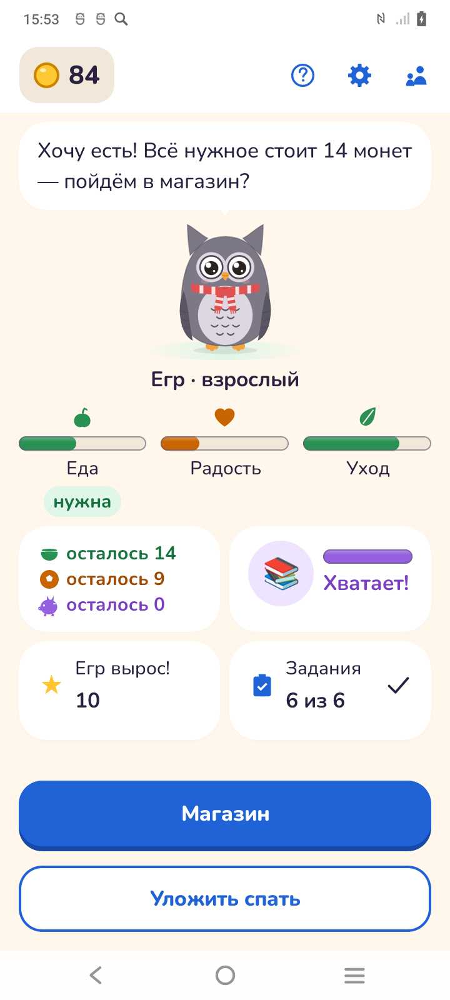
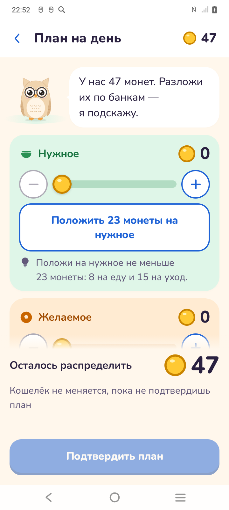
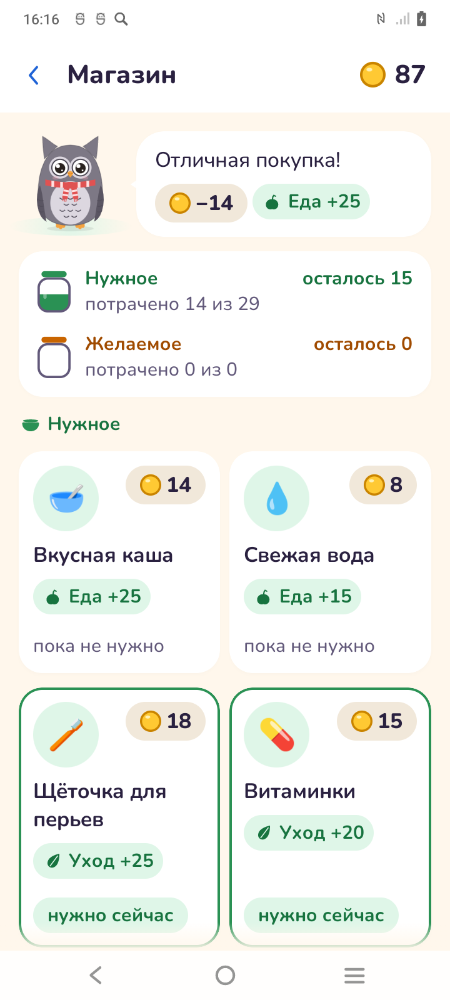
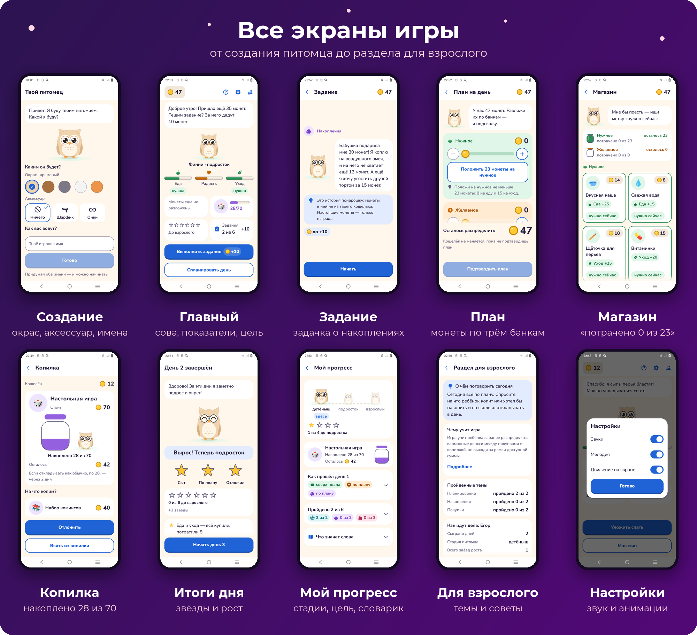
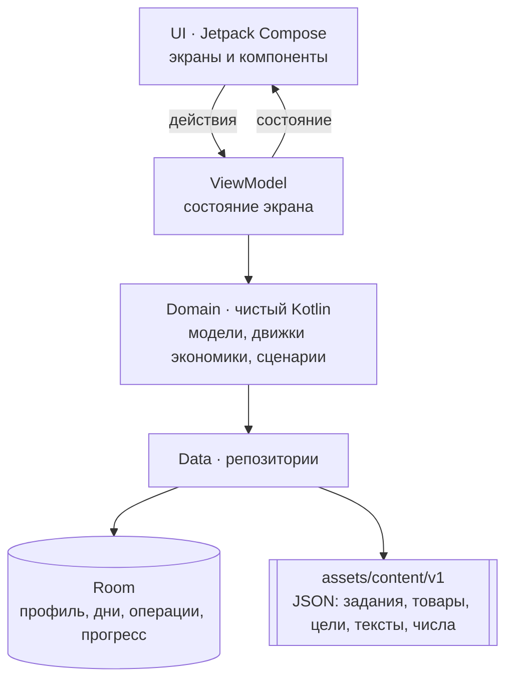

<div align="center">

# Питомец Финни

**Игра о финансовой грамотности для детей 7–11 лет**<br>
по техническому заданию №6 Департамента финансов города Москвы


&nbsp;
&nbsp;


</div>

## Об игре

Ребёнок заводит совёнка, и каждый игровой день тот получает монеты. Перед
покупками ребёнок раскладывает их по трём банкам: «Нужное», «Желаемое» и
«Копилка». Потом кормит сову, покупает радости и копит на цель. Вечером итоги
дня показывают, что стало с питомцем и почему он вырос или нет.

Реальных денег, платежей, рекламы и сбора персональных данных нет. Монеты
игровые, имя придумывается игровое, приложение работает без сети.

Игровой день состоит из пяти шагов:

1. **Утро.** Приходят монеты, остаток прошлого дня переходит на сегодня.
2. **Задание.** Денежная задачка с объяснением любого ответа.
3. **План.** Монеты кошелька раскладываются по трём банкам.
4. **Покупки.** Магазин и откладывание на цель; план сравнивается с фактом.
5. **Итоги.** Сова ложится спать, ребёнок видит звёзды «Сыт», «По плану» и
   «Отложил»; совёнок растёт в три стадии.

Первый запуск проводит через обучение из семи шагов. Для родителя есть
отдельный раздел за простым примером: темы, пройденные заданиями, подсказки для
разговора с ребёнком и удаление игры.

<p align="center">
  
</p>

## Стек

| Компонент | Выбор |
|---|---|
| Язык | Kotlin 2.2.10 |
| UI | Jetpack Compose, Material 3 |
| Внедрение зависимостей | Hilt 2.60.1 |
| Хранилище | Room 2.8.5, DataStore Preferences |
| Навигация | Navigation Compose 2.9.0 |
| Контент | kotlinx.serialization (JSON в `assets`) |
| Сборка | AGP 9.2.1, Gradle 9.5.0 |

`minSdk` 26, портретная ориентация, от 360 dp.

## Сборка и запуск

Нужны Android SDK с платформой **android-37.1** и JDK 21 (Gradle скачает его
сам или возьмёт JBR из Android Studio). Готовый APK лежит в
[релизах](https://github.com/egor-ver/finny-pet/releases/latest).

```bash
git clone https://github.com/egor-ver/finny-pet.git
cd finny-pet
./gradlew :app:installDebug        # на подключённый телефон или эмулятор
./gradlew :app:assembleRelease     # app/build/outputs/apk/release/app-release.apk
./gradlew :app:testDebugUnitTest   # 837 юнит-тестов
./gradlew :app:connectedDebugAndroidTest   # 242 инструментальных, нужно устройство
```

- Release подписан отладочным ключом Android, поэтому ставится на телефон
  сразу, но для публикации в магазине нужен свой ключ.
- `local.properties` в репозитории нет: Android Studio создаст его сама, без IDE
  задайте `sdk.dir` или переменную `ANDROID_HOME`.
- `compileSdk` 37.1 при `targetSdk` 36: несколько зависимостей androidx требуют
  компиляции против API 37, а поведение приложения определяет только `targetSdk`.
- `android.disallowKotlinSourceSets=false` в `gradle.properties` нужен, пока KSP
  регистрирует сгенерированный код через `kotlin.sourceSets`, что AGP 9 запрещает.
- R8 выключен.

## Архитектура



Один модуль `app`, слои разделены пакетами. Домен не импортирует Android и
зависит только от своих интерфейсов, реализации подставляет Hilt.

```
app/src/main/
  java/ru/finnypet/app/
    domain/   модели, движки экономики и роста, сценарии (use cases)
    data/     Room, репозитории, чтение контента, DataStore
    ui/       экраны, компоненты, тема, навигация, звук
    di/       модули Hilt
  assets/content/v1/   контент: задания, товары, цели, окрасы, числа экономики
  res/                 строки, шрифт Nunito, звуки, иконка
```

- **Контент отдельно от кода.** Тексты, товары, цели, задания и числа экономики
  лежат в JSON, новое задание добавляется без правки логики.
- **Состояние игрока** живёт в Room; покупка или перевод пишутся одной
  транзакцией. Итоги дня не хранятся, а пересчитываются из плана и операций.
- **Сова нарисована кодом** на `Canvas`: эмоции видны на мордочке, окрас
  задаётся цветами в `pets.json`, а APK получается меньше. Иконка приложения
  тоже вектор, исходник лежит в `design/`.
- **Доступность.** Кнопки от 48 dp, текст от 16 sp, описания для TalkBack,
  звуки, мелодия и анимации выключаются в настройках; экраны проверены на 360 dp
  при шрифте ×2,0.

## Тесты

Юнит-тесты покрывают движки экономики, сценарии, парсер контента, состояния
экранов и тексты. Отдельный тест прожигает пять игровых дней и проверяет, что
сова доходит до последней стадии. Инструментальные тесты проверяют Room, сценарии
на настоящей базе и экраны вместе с доступностью.

## Авторы

- [egor-ver](https://github.com/egor-ver): код и дизайн приложения.
- [eltsovan2006](https://github.com/eltsovan2006): контент: задания, товары, цели,
  тексты и словарь терминов.

## Лицензии

Библиотеки открытые, в основном Apache 2.0, список в `gradle/libs.versions.toml`.
Шрифт Nunito распространяется по SIL OFL 1.1, текст лицензии лежит в
[design/OFL.txt](design/OFL.txt). Сова, банки, монеты и иконка нарисованы кодом,
иконки товаров и целей это системные эмодзи, звуки и мелодия сгенерированы
программно для этого проекта.
